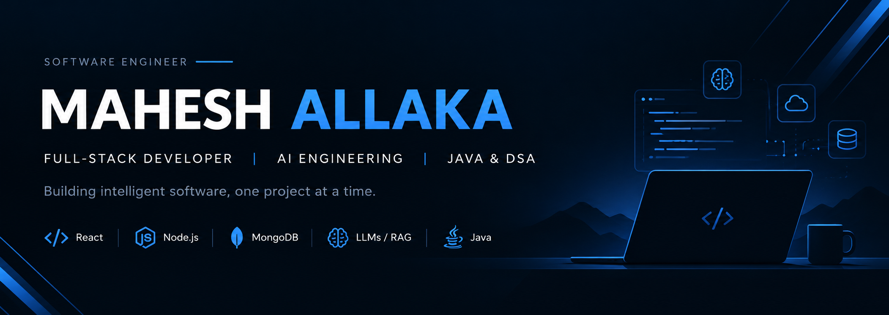

  

 

# Hey, I'm Mahesh 👋

### Full-Stack Developer | AI Engineering | Java & DSA

Building full-stack applications and AI-powered developer tools.

 

---

## 💫 About Me

- 🔭 Building **CodeLens**, an AI-powered GitHub codebase assistant.
- 💻 Developing full-stack applications using React, Node.js, and MongoDB.
- 🤖 Exploring LLMs, RAG, and vector databases.
- 🧠 Practicing Data Structures and Algorithms using Java.
- 🎯 Focused on building practical software and improving my engineering skills.

## 🛠️ Tech Stack

### Languages

  
  

### Frontend

  
  
  
  

### Backend & Databases

  
  
  
  

### AI Engineering

  
  
  
  

### Tools

  
  
  

---

<h2 align="center">🚀 Featured Projects</h2>

  A selection of applications and developer tools I've built.

 

<table>
<tr>
<td width="50%" valign="top">

<h3>🔷 CodeLens</h3>

  
  

An AI-powered GitHub codebase assistant that helps developers
explore repositories using code embeddings, vector search,
and large language models.

**Tech Stack**

`React` `Node.js` `MongoDB` `ChromaDB` `Ollama` `Gemini`

 

</td>
<td width="50%" valign="top">

<h3>💬 MERN Chat Application</h3>

  
  

A real-time messaging application with authentication
and live communication using Socket.IO.

**Tech Stack**

`React` `Express` `MongoDB` `Socket.IO` `JWT`

 

</td>
</tr>

<tr>
<td width="50%" valign="top">

<h3>🚕 E-Rickshaw Booking System</h3>

  
  

A campus-focused booking application with location
and distance integration to support the booking workflow.

**Tech Stack**

`React` `Node.js` `JavaScript` `Google Maps API`

 

</td>
<td width="50%" valign="top">

<h3>📊 Expense Analytics</h3>

  
  

An expense management dashboard focused on transaction
management, filtering, and financial visualization.

**Tech Stack**

`JavaScript` `React` `Charts` `Tailwind CSS`

 

</td>
</tr>
</table>

 

  <i>Building practical software through continuous learning and experimentation.</i>

---
<h2 align="center">📊 GitHub Statistics</h2>

 

### BUILD. LEARN. DEBUG. REPEAT.

